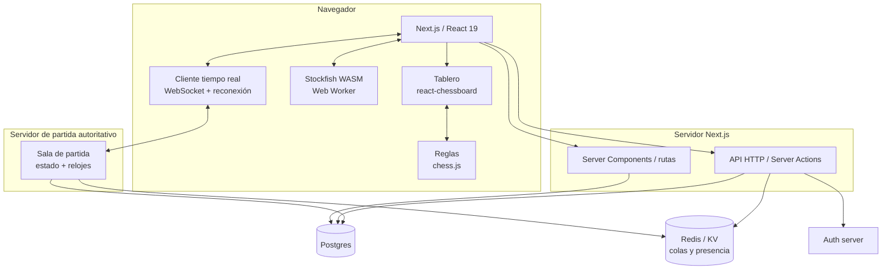

# Arquitectura — webajedrez

> Documento de decisiones técnicas. Última revisión: versiones verificadas contra el registro de npm.
> Formato ADR (Architecture Decision Record): contexto → decisión → consecuencias.

---

## 1. Objetivos y restricciones

### Funcionales (objetivo final, no del MVP)

1. Jugar en el mismo dispositivo (hot-seat).
2. Jugar contra el motor con niveles.
3. Jugar online 1v1 en tiempo real con reloj.
4. Cuentas, historial de partidas y rating.
5. Análisis post-partida y puzzles.

### No funcionales

| Requisito | Objetivo | Por qué |
|---|---|---|
| Latencia de jugada percibida | < 100 ms (P95) | Por encima de ~150 ms se siente "pegajoso" |
| Tiempo hasta primer tablero jugable | < 2 s en 4G media | El tablero debe pintar antes que cargue el motor |
| Peso del motor | Carga diferida y opcional | El NNUE de Stockfish son decenas de MB; nunca bloquea el primer render |
| Móvil primero | ≥ 60 % del tráfico esperado | El ajedrez online se consume mucho en móvil |
| Coste en reposo | 0 € | Requisito de proyecto personal |
| Función sin conexión | Tablero y puzzles sí; online no | PWA con caché |

### Restricción explícita

**No se implementa desde cero:** tablero, reglas del ajedrez, generador de movimientos legales, detección de jaque mate/tablas, parseo de PGN/FEN ni el motor de ajedrez. Todo eso son librerías existentes con años de batalla. Lo que sí es nuestro: **experiencia de usuario, estado de partida autoritativo, relojes, matchmaking y progresión**.

---

## 2. Vista de componentes



**Principio rector:** el cliente **nunca** decide si una jugada es legal en una partida online. El cliente propone, el servidor valida contra su propio estado y aplica el resultado. En modo local y contra el motor, el cliente sí manda (no hay nada que proteger).

---

## 3. Decisiones (ADRs)

### ADR-001 — Framework: Next.js 16 + React 19 + TypeScript

- **Versiones verificadas:** `next@16.4.3`, `react@19.3.1`, `tailwindcss@4.3.3`.
- **Decisión:** Next.js App Router con TypeScript estricto, Tailwind 4 para estilos y componentes propios (estilo shadcn/ui, copiados al repo, no como dependencia de caja negra).
- **Contexto:** un solo repo para landing, app jugable y API. Rutas dinámicas para `/game/[id]`, `/player/[user]`.
- **Consecuencias:**
  - El tablero es inevitablemente client-side (`"use client"`). Todo lo que rodea al tablero (datos del jugador, historial, SEO de la landing) sí puede ser Server Component.
  - El motor debe vivir en un **Web Worker**, nunca en el hilo principal.
  - Vercel es el destino natural, pero el servidor de tiempo real **no** va en Vercel (ver ADR-005): funciones serverless no mantienen WebSockets de larga duración.
- **Alternativas descartadas:** SvelteKit (menos ecosistema de componentes), Vite + React SPA (peor SEO y habría que inventar el backend), Astro (excelente para la landing, incómodo para una app con estado complejo).

### ADR-002 — Tablero: `react-chessboard` (MIT) para empezar; `chessground` (GPL) como opción

Es la decisión con más consecuencias legales del proyecto.

| Librería | Versión | Licencia | Notas |
|---|---|---|---|
| `react-chessboard` | 5.12.1 | **MIT** | Componente React nativo, usa `@dnd-kit` para drag & drop, React 19 como peer. Personalización por props/CSS. |
| `@lichess-org/chessground` | 10.5.0 | **GPL-3.0-or-later** | El tablero de Lichess. El mejor del mundo en sensación táctil, rendimiento y temas. Requiere Node ≥ 24 y manipula el DOM directamente. |

- **Contexto resuelto:** el proyecto es **de código abierto bajo AGPL-3.0** (ver [`LICENCIAS.md`](LICENCIAS.md)). Por tanto **ambas librerías son legales** y la decisión pasa a ser puramente técnica.
- **Decisión:** **`react-chessboard`** (MIT) como tablero inicial.
- **Consecuencias:**
  - Mejor encaje con React 19 (es un componente nativo; `chessground` manipula el DOM de forma imperativa y exige un wrapper propio).
  - Requiere menos código para llegar a "se puede jugar".
  - Da menos "sensación Lichess", pero es perfectamente digno.
  - **Ventaja de reserva:** al ser MIT, si algún día se quisiera cerrar el código, esta pieza no lo impide. Es un seguro gratuito.
- **Ruta de mejora disponible:** `@lichess-org/chessground@10.5.0` (GPL-3, ya compatible) sustituye a `react-chessboard` si el tablero "no se siente bien". Es la mejora de UX más rentable que existe y está permitida desde el primer día.
- **Regla de diseño derivada:** *encapsular el tablero*. El resto de la app no debe importar la librería del tablero directamente, solo nuestro `components/board`. Cambiar de librería debe ser tocar un fichero.

### ADR-003 — Reglas: `chess.js` 1.4.0 (BSD-2-Clause)

- **Decisión:** `chess.js` como fuente de verdad de legalidad en cliente.
- **Por qué `chess.js` y no `chessops`:** `chessops@0.15.1` es técnicamente superior (inmutable, PGN/SAN robusto, casos límite mejor cubiertos, es lo que usa Lichess) y **su licencia GPL-3 ya es compatible** con el proyecto. Aun así, `chess.js` es más simple de usar, tiene la API más documentada y es sobradamente correcto para ajedrez estándar. Se mantiene `chessops` como recambio si aparecen problemas reales de PGN o si algún día hay variantes.
- **Consecuencias:**
  - El servidor necesita la **misma** lógica de legalidad. Con `chess.js` (BSD) puede importarse en Node sin contagiar licencia. Este es el argumento decisivo.
  - `chess.js` recrea el objeto al cargar FEN; para el motor hay que serializar FEN tras cada jugada. Es barato.
- **Uso concreto:** `new Chess(fen)`, `moves({ verbose: true })` para resaltar destinos legales, `move({ from, to, promotion })` para aplicar, `isCheckmate()`, `isDraw()`, `isThreefoldRepetition()`, `isInsufficientMaterial()`, `pgn()`, `fen()`.

### ADR-004 — Motor: Stockfish WASM en Web Worker, carga diferida

- **Versión/licencia:** **`stockfish@19.0.1`** — build WASM oficial de Stockfish 19, licencia **GPL-3.0**, mantenido por Nathan Rugg (nmrugg), con patrocinio de Chess.com. Incluye variantes `--lite` (red NNUE pequeña) y `--single-threaded` (necesaria para servir sin cabeceras COOP/COEP). Verificado: 205 MB de paquete con todas las variantes, de los cuales el navegador descarga solo la que se use.
- **Nota:** se evita `@lichess-org/stockfish-web@0.5.0` porque es **AGPL-3.0**: siendo el proyecto AGPL-3 también sería compatible, pero `stockfish@19.0.1` es GPL-3 puro, está más orientado a uso general y no obliga a nada extra.
- **Decisión:** ejecutar Stockfish **en el navegador** dentro de un Web Worker, cargado sólo cuando el usuario entra en "jugar contra el motor" o "analizar".
- **Por qué en el navegador:**
  - Coste de CPU en servidor = 0 €. El análisis lo paga el dispositivo del usuario.
  - Latencia mínima y análisis "instantáneo" al mover.
  - Escala infinitamente sin tocar infraestructura.
- **Niveles de dificultad:** no se simula "torpeza" con esperas aleatorias. Se usan parámetros reales:
  - `Skill Level` (0-20) + `MultiPV` alto para el nivel bajo, `depth` bajo, y opcionalmente limitar fuerza con `UCI_LimitStrength` / `UCI_Elo`.
  - Tabla de niveles propuesta: 1 → Skill 0 / depth 1; 4 → Skill 3 / depth 5; 8 → Skill 8 / depth 10; 12 → Skill 13 / depth 13; 16 → Skill 17 / depth 16; 20 → Skill 20 / depth 20.
- **Gestión del worker:** un único worker reutilizado (crear/destruir workers es caro). Cancelar búsquedas con `stop` antes de lanzar la siguiente. Protocolo UCI sobre `postMessage`.
- **Consecuencias legales:** **resueltas, no pendientes.** El proyecto completo se publica bajo **AGPL-3.0** con repo público (ver [`LICENCIAS.md`](LICENCIAS.md)), así que servir el WASM del motor no plantea ninguna cuestión de compatibilidad: basta mantener la atribución y el enlace a la fuente en `/creditos`.
- **Nota sobre motores permisivos:** no existe alternativa real. Todos los motores fuertes actuales (Stockfish, Ethereal, Berserk, Seer, Lc0) son GPL-3, y los permisivos son o muy débiles (~1800 Elo, sin red neuronal) o de licencia dudosa. No merece la pena perseguirlo: con el proyecto en AGPL-3 la pregunta desaparece.
- **Obligación concreta y única:** atribución a Stockfish + enlace a su código fuente en la página de créditos. Ya está redactada en `LICENCIAS.md` §8.

### ADR-005 — Transporte multijugador: WebSocket con estado autoritativo por partida

Tres candidatos evaluados:

| Opción | Modelo | Encaje |
|---|---|---|
| **Cloudflare Durable Objects** | 1 objeto = 1 partida, con estado en memoria y SQLite opcional, en el edge | **Arquitectura ideal para 1v1.** Sin BD por jugada, hibernación con WebSocket, escala natural por partida. |
| **Servidor Node propio** (`ws` o Colyseus) + Redis | Un proceso mantiene todas las salas | Control total, se depura en local sin emuladores, requiere gestionar despliegue y escala. |
| **Supabase Realtime** (broadcast + presence) | Mensajes entre clientes, sin autoridad | Rapidísimo de montar, pero **alguien tiene que validar las jugadas**: sin servidor autoritativo cualquiera puede hacer trampas con un cliente modificado. Sirve solo para partidas entre amigos. |

- **Decisión:** construir el servidor de partida como **módulo independiente y portable**, con el estado de una partida encapsulado en una clase/objeto puro (`GameRoom`) sin dependencias del transporte.
  1. **Desarrollo local:** proceso Node (`ws`). Depurable, sin emuladores, sin lock-in.
  2. **Producción (gratis):** **Cloudflare Workers + Durable Objects en el plan Free** (solo backend SQLite, que es el que conviene) con la **WebSocket Hibernation API**. Verificado: 100 000 peticiones/día y 13 000 GB-s/día, suficiente para decenas de miles de jugadas diarias, y **al pasarse el límite las operaciones fallan en lugar de facturar**. Descartados Fly.io y Railway: ya no tienen plan gratuito permanente. Detalle en [`DESPLIEGUE.md`](DESPLIEGUE.md).
- **Consecuencias:** el `GameRoom` debe ser **determinista y testeable en unit tests sin red**. Ese es el requisito de diseño que hace viable la migración.
- **Descartado para el MVP:** bases de datos de tiempo real sin autoridad. Un ajedrez donde el cliente manda es un ajedrez trampeable.

### ADR-006 — Persistencia: Postgres + Drizzle ORM

- **Versiones verificadas:** `drizzle-orm@0.45.4`.
- **Decisión:** Postgres gestionado (**Neon**, plan Free) + Drizzle para esquema y migraciones versionadas en el repo. **No Supabase:** su plan gratuito pausa los proyectos inactivos a los 7 días.
- **Consecuencias:**
  - Drizzle es SQL-first, sin runtime pesado y encaja con serverless.
  - **Las jugadas no se guardan una a una** (ver §5): se guarda el PGN completo de la partida más el FEN final. Para repetición basta con re-jugar el PGN en cliente. Guardar una fila por jugada multiplica por ~80 el volumen sin dar nada a cambio en esta escala.
  - Escritura de partida: **una sola escritura al terminar**, más posibles *checkpoints* cada N jugadas para sobrevivir a una caída del servidor de partida (ver §7).

### ADR-007 — Autenticación: Better Auth

- **Versión verificada:** `better-auth@1.7.15` (MIT), con integración oficial para Next.js 16 y adaptador Drizzle.
- **Decisión:** Better Auth con email+contraseña y, opcionalmente, OAuth de GitHub/Google. Sesión por cookie `httpOnly`.
- **Regla crítica:** el servidor de tiempo real **no** habla con el proveedor de auth. El usuario obtiene un **token de partida de corta duración** (JWT firmado, ~60 s, con `sub` = id de usuario y `gameId`) desde la API HTTP y lo presenta al abrir el WebSocket. El token lleva `aud` restringido a esa partida.
- **Consecuencias:** un WebSocket no puede autenticarse con la cookie de sesión de forma fiable entre subdominios; el token efímero lo resuelve y limita el daño de una fuga.
- **Alternativa descartada:** magic links por email como método principal (fricción alta y dependencia de un proveedor de correo). Puede añadirse después.
- **Futuro:** login con **Lichess OAuth** o **Chess.com** para importar identidad y partidas. No en el MVP.

### ADR-008 — Rating: Glicko-2

- **Decisión:** Glicko-2 (el mismo sistema que Lichess), no Elo puro.
- **Motivo:** con pocos jugadores activos, Elo es inestable y arbitrario; Glicko-2 modela la incertidumbre (`RD`) y la volatilidad (`σ`), y converge mucho mejor.
- **Implementación:** determinista, ~100 líneas, testeable con los ejemplos de referencia del paper de Mark Glickman. **Se implementa y se testea a mano; el ajuste de rating se ejecuta en el servidor** al cerrar la partida.
- **Consecuencias:** cada jugador tiene `(rating, rd, sigma)` **por grupo de control de tiempo** (bullet/blitz/rapid y "correspondencia" si llega). El nuevo rating se calcula en una transacción junto con el insert de la partida.
- **Regla anti-abuso:** la partida solo afecta al rating si hay ≥ 2 jugadas y ambos jugadores han realizado al menos una. Abortar antes no penaliza.

### ADR-009 — Tiempo real: cliente con reloj interpolado y reconexión

- **Decisión:** el reloj es del servidor. El cliente **nunca** descuenta tiempo por su cuenta como fuente de verdad; solo interpola visualmente entre mensajes y se resincroniza con el estado del servidor en cada jugada.
- **Detalle completo en §7.**

---

## 4. Modelo de datos

### Convenciones

- IDs: `text` (ULID) → ordenables por tiempo, seguros por URL, sin secuencias expuestas.
- Tiempo: `timestamptz` en UTC. Milisegundos de reloj como `integer`.
- Dinero de rating: enteros siempre.

### Tablas

```
user                     (gestionada por Better Auth)
  id, name, email, emailVerified, image, createdAt, updatedAt

profile                  (1:1 con user, datos públicos del jugador)
  userId (PK, FK), username (unique), bio, title (nullable: GM/IM...),
  country (char 2, nullable), createdAt

rating                   (una fila por jugador y pool)
  userId (PK), pool ("bullet"|"blitz"|"rapid"|"classical") (PK),
  rating (int, def. 1500), rd (real, def. 350), sigma (real, def. 0.06),
  games (int, def. 0), provisional (bool, def. true), updatedAt

game
  id (PK)                  -- ULID, también es el id de sala
  whiteId, blackId         -- nullable solo en partidas bot / anónimas
  kind                     -- "online" | "bot" | "local" | "correspondence"
  pool                     -- "bullet"|"blitz"|"rapid"|"classical"|null
  initialMs, incrementMs   -- reloj: ms iniciales + incremento Fischer
  status                   -- "waiting"|"playing"|"finished"|"aborted"
  result                   -- "1-0"|"0-1"|"1/2-1/2"|null
  termination              -- "checkmate"|"resign"|"timeout"|"stalemate"|
                              "threefold"|"fifty_move"|"insufficient"|"aborted"|
                              "draw_agreed"|"server_crash"
  pgn (text)               -- PGN completo con cabeceras
  finalFen (text)
  ratingWhiteDelta, ratingBlackDelta (int, nullable)
  moveCount (int)
  createdAt, startedAt, endedAt

rating_history           -- opcional: gráficas de progreso
  id, userId, pool, ratingBefore, ratingAfter, gameId, createdAt

puzzle                   -- si se importa el dataset de Lichess (CC0)
  id (text, id de lichess), fen, solutionUciList, themes, rating, popularity

puzzle_attempt
  id, userId, puzzleId, solved (bool), msSpent, createdAt
```

### Índices mínimos

```
game(whiteId, createdAt desc)     -- historial de un jugador
game(blackId, createdAt desc)
game(status) partial where status='waiting'
profile(username) unique
rating(pool, rating)              -- clasificación
puzzle_attempt(userId, puzzleId) unique
```

### Por qué no hay tabla `move`

Guardar una fila por jugada es el error clásico de esta app. Con 10 000 partidas son ~800 000 filas para servir **una** funcionalidad (repetir una partida) que se resuelve en cliente re-jugando el PGN en milisegundos. El PGN es el formato estándar, exportable e interoperable: un usuario puede llevarse sus partidas a Lichess. Se reconsidera solo si algún día se necesitan consultas analíticas por jugada (por ejemplo: "todas las partidas donde se jugó la Najdorf").

---

## 5. Protocolo tiempo real

### Autenticación y conexión

```
1. Cliente (HTTP)  POST /api/games/{gameId}/ws-ticket
                   → { ticket: "<jwt firmado, aud=game, exp=60s>" }
2. Cliente (WS)    conecta a wss://rt.<host>/ws?game={gameId}&ticket=<jwt>
3. Servidor        valida firma, aud, exp, pertenencia a la partida
                   → { t: "ready", ... }
```

### Mensajes

**Cliente → servidor**

| `t` | Payload | Notas |
|---|---|---|
| `move` | `{ cid, ply, uci, promotion? }` | `cid` = client move id (ULID) para idempotencia. `ply` = número de semijugada esperado. |
| `resign` | `{ cid }` | |
| `offer_draw` | `{ cid }` | |
| `accept_draw` | `{ cid }` | |
| `abort` | `{ cid }` | Solo si `ply < 2`. |
| `rematch_offer` | `{ cid }` | |
| `rematch_accept` | `{ cid }` | |
| `sync` | `{}` | Fuerza reenvío de estado completo. |
| `ping` | `{ cid, t0 }` | Medición de RTT. |

**Servidor → cliente**

| `t` | Payload | Notas |
|---|---|---|
| `ready` | `{ gameId, you: "white"\|"black", state }` | Estado completo tras conectar. |
| `state` | `{ fen, moves: [{uci, ply, by, at}], clocks, status, turn, ply, lastCid? }` | Estado autoritativo completo. |
| `ack` | `{ cid, accepted: bool, error?, ply }` | Respuesta a una intención del cliente. |
| `clock` | `{ whiteMs, blackMs, turn, at }` | Emitido cada ~1 s y en cada cambio de turno. |
| `end` | `{ result, termination, ratingDeltas? }` | |
| `opponent` | `{ connected: bool, graceMsLeft? }` | Presencia. |
| `pong` | `{ cid, t0, t1 }` | |

### Reglas de robustez

1. **Idempotencia por `cid`.** El servidor recuerda los últimos N `cid` de cada jugador. Un reintento devuelve el mismo `ack` en lugar de aplicar la jugada dos veces.
2. **Orden por `ply`.** Si llega `ply` menor al esperado → `ack` con `accepted:false, error:"stale"` y `state`. Si llega salto → `state` completo.
3. **Resincronización total.** Ante cualquier duda, el servidor manda `state` completo (FEN + lista de jugadas + relojes). El cliente sustituye su estado y re-pinta. Es más simple y más robusto que cualquier parche incremental.
4. **Reconexión.** Backoff exponencial con jitter: 250 ms → 500 → 1000 → 2000 → 4000, máximo 10 s. Al reconectar, primer mensaje `sync`.
5. **Sin confianza en el cliente.** Validaciones en servidor: es el turno del jugador, la pieza es suya, la jugada es legal en el estado del servidor, la promoción es válida, la partida está en `playing`.

---

## 6. Estado de la partida en el servidor

`GameRoom` es el corazón. Debe ser **puro y determinista**: entra un mensaje + tiempo actual, sale una nueva lista de mensajes. Nada de `setTimeout` sueltos ni de red dentro.

```ts
type GameRoomState = {
  gameId: string;
  chess: Chess;                  // chess.js, autoridad de legalidad
  status: 'waiting' | 'playing' | 'finished' | 'aborted';
  white: { userId: string; connected: boolean; msLeft: number };
  black: { userId: string; connected: boolean; msLeft: number };
  initialMs: number;
  incrementMs: number;
  turnStartedAt: number;         // epoch ms, del reloj del SERVIDOR
  ply: number;
  moves: { uci: string; ply: number; by: 'w'|'b'; at: number }[];
  recentCids: Map<string, AckResponse>;
  drawOfferBy: 'w' | 'b' | null;
};
```

### Reglas del reloj (Fischer)

1. `turnStartedAt` se fija cuando empieza a correr el turno.
2. Al aplicar una jugada del jugador `X`:
   - `elapsed = now - turnStartedAt`
   - `X.msLeft -= max(0, elapsed - lagCompensation)` **(nunca menos de 0)**
   - Si `X.msLeft <= 0` → la partida termina por `timeout` **antes** de aplicar la jugada.
   - Si no: aplicar la jugada, `X.msLeft += incrementMs`, `turnStartedAt = now`.
3. `lagCompensation` = `clamp(rtt/2, 0, 250 ms)` usando la mediana de los últimos pings de ese jugador. Sin esto, alguien con mala conexión pierde tiempo que no consumió.
4. **Nadie mueve y el reloj corre:** un temporizador del servidor (o un `alarm` en Durable Objects) debe declarar la derrota por tiempo sin depender de que alguien envíe un mensaje. Es el fallo más habitual: un jugador cierra la pestaña y la partida queda colgada para siempre.

### Fin de partida: causas y cómo se detectan

| `termination` | Detección |
|---|---|
| `checkmate` | `chess.isCheckmate()` tras la jugada |
| `stalemate` | `chess.isStalemate()` |
| `insufficient` | `chess.isInsufficientMaterial()` |
| `threefold` | `chess.isThreefoldRepetition()` |
| `fifty_move` | `chess.isDrawByFiftyMoves()` si la versión lo expone; si no, contador propio |
| `timeout` | reloj a 0 (servidor) |
| `resign` | mensaje `resign` |
| `draw_agreed` | `offer_draw` + `accept_draw` |
| `aborted` | `abort` con `ply < 2`, o desconexión total antes de 2 jugadas |
| `server_crash` | recuperación desde checkpoint sin poder continuar |

---

## 7. Reconexión y abandono

- Al caer un WebSocket: el jugador queda `connected: false` y **el reloj sigue corriendo**. Es lo correcto: abandonar cuesta tiempo.
- **Ventana de gracia** de 15 s durante la cual el jugador puede volver. Al volver recibe `state` completo y recupera el control.
- Si el jugador no vuelve en la ventana de gracia **y** su reloj aún tiene tiempo: la partida continúa hasta que su reloj llegue a 0 (comportamiento de Lichess). No se declara derrota por desconexión si hay tiempo en el reloj; se declara por `timeout`.
- Si **ambos** jugadores están desconectados > 60 s → la partida se cierra como `aborted`, sin cambio de rating.
- **Persistencia intermedia:** cada 10 jugadas (o cada 30 s) el servidor guarda `{pgn, clocks, status, ply}` en Postgres. Si el proceso muere, al reiniciar puede:
  - reanudar (si ambos siguen conectados), o
  - cerrar la partida como `server_crash` sin cambio de rating. **Nunca** inventar un resultado.
- **Revancha:** misma sala, nueva partida, colores invertidos, y **solo cuenta para rating si la partida anterior fue puntuada**.

---

## 8. Estructura del repositorio

```
webajedrez/
├─ apps/
│  ├─ web/                      # Next.js 16
│  │  ├─ app/
│  │  │  ├─ (marketing)/page.tsx
│  │  │  ├─ play/page.tsx               # selector de modo
│  │  │  ├─ play/local/page.tsx         # Fase 0
│  │  │  ├─ play/bot/page.tsx           # Fase 1
│  │  │  ├─ game/[id]/page.tsx          # Fase 2
│  │  │  ├─ analysis/page.tsx           # Fase 4
│  │  │  ├─ puzzles/page.tsx            # Fase 4
│  │  │  ├─ @modal/...                  # diálogos interceptados
│  │  │  └─ api/                        # rutas HTTP (auth, tickets, seek)
│  │  ├─ components/
│  │  │  ├─ board/                      # ÚNICO lugar que importa el tablero
│  │  │  │  ├─ ChessBoard.tsx           # adaptador sobre react-chessboard
│  │  │  │  ├─ board-theme.ts
│  │  │  │  └─ useChessGame.ts          # hook: estado + chess.js
│  │  │  ├─ clock/Clock.tsx
│  │  │  ├─ engine/EvalBar.tsx
│  │  │  └─ ui/                         # primitivas propias
│  │  └─ lib/
│  │     ├─ chess/                      # reglas, notación, PGN
│  │     ├─ engine/                     # wrapper UCI + worker
│  │     └─ realtime/                   # cliente WS + reconexión
│  └─ rt/                       # servidor de partida (Node/ws, luego DO)
│     ├─ src/GameRoom.ts                # lógica pura, sin red   ← núcleo
│     ├─ src/clock.ts
│     ├─ src/transport.node.ts          # adaptador WebSocket
│     └─ test/GameRoom.spec.ts          # unit tests sin red
├─ packages/
│  ├─ shared/                   # tipos de mensajes, zod schemas, ULID
│  └─ rating/                   # Glicko-2 + tests contra el paper
├─ docs/
└─ package.json                 # npm workspaces (+ turborepo cuando / si duele)
```

**Regla de oro de la estructura:** `GameRoom` no importa nada de `next`, ni de `ws`, ni de red. Solo `chess.js`, `@webajedrez/shared` y `@webajedrez/rating`. Es lo que permite testearlo entero en milisegundos y reutilizarlo en Durable Objects.

---

## 9. Seguridad

| Riesgo | Mitigación |
|---|---|
| Cliente modificado que propone jugadas ilegales | Servidor valida con su propio `Chess`. No hay excepciones. |
| Suplantación de jugador en el WS | Ticket JWT efímero con `aud` = gameId, firmado en servidor. |
| Reintento duplicado de jugada | `cid` idempotente + `ply` esperado. |
| Spam de mensajes | Rate limit por conexión (p. ej. 10 msg/s) y cierre con código 1008 si se excede. |
| Fuga de la lista de partidas | Sala privada = id ULID no adivinable. Salas públicas se listan a propósito. |
| XSS en nombres de usuario | Escapado por defecto de React; saneado de `bio`; **nunca** `dangerouslySetInnerHTML` con contenido de usuario. |
| CSRF | Server Actions + cookies `SameSite=Lax`; el WS no usa cookies. |
| Trampas con motor (engine cheating) | Fuera del MVP. Ruta futura: análisis de correlación de jugadas con Stockfish, distribución de tiempos de jugada, detección de patrones anómalos. No es un problema resoluble, es un problema gestionable. |
| Enumeración de emails | Mensajes de auth genéricos. |

---

## 10. Rendimiento

- **Tablero primero.** El primer render no incluye `chess.js` completo ni el motor. Code split: `play/bot` y `analysis` cargan el motor bajo demanda con `await import()`.
- **Worker del motor:** fichero WASM servido con `Cache-Control: public, max-age=31536000, immutable` y hash en el nombre. Se descarga una vez por versión.
- **Net NNUE:** usar la red pequeña para niveles bajos y descargar la grande solo si el usuario pide análisis profundo. Ofrecer "análisis limitado" y "análisis completo" en la UI.
- **Animación de piezas:** CSS transforms, nunca re-render de React por frame. `will-change: transform` solo durante la animación.
- **Salas:** en memoria, cero consultas a BD por jugada. La BD se toca al empezar (opcional), cada 30 s (checkpoint) y al terminar.
- **Presupuesto de bundle:** < 200 KB gzip para la ruta de juego sin motor.
- **PWA:** manifest + service worker con precache de la shell. Instalable. El tablero local funciona offline.

---

## 11. Despliegue y costes

| Pieza | Dónde | Coste esperado |
|---|---|---|
| App Next.js | Vercel Hobby (o Cloudflare Workers) | 0 € |
| Postgres | Neon Free | 0 € |
| Servidor RT | **Cloudflare Workers + Durable Objects (plan Free)** | **0 €** |
| Motor | Navegador del usuario | 0 € |
| Puzzles | Dataset Lichess (CC0), estático o en BD | 0 € |
| Dominio | — | ~10 €/año |

**Entornos:** `dev` (local, Postgres en Docker o PGlite) y `prod`. Sin staging al principio: los tests de `GameRoom` cubren lo que un staging cubriría.

---

## 12. Riesgos y mitigaciones

| Riesgo | Impacto | Mitigación |
|---|---|---|
| El multijugador se come el proyecto | Alto | Fases 0 y 1 son útiles por sí solas y ya están desplegadas antes de tocar red. |
| Reloj/reconexión con casos límite infinitos | Alto | `GameRoom` puro + tests de reloj con tiempo inyectado (nunca `Date.now()` dentro de la lógica, siempre `now` como parámetro). |
| Licencia GPL del motor fuerza apertura del código | Medio | Decidirlo **antes** de la Fase 1 (ADR-002/ADR-004). |
| Cold start / procesos que duermen en el host RT | Medio | Elegir host con procesos largos o pasar a Durable Objects. |
| Inflación de alcance (torneos, variantes, chat, clubes) | Alto | Regla: nada entra al roadmap hasta que la fase actual esté en producción. |
| Pocos jugadores → matchmaking vacío | Medio | Bot de relleno ("juega contra la máquina mientras esperas") + enlaces de desafío directos. |
| Trampas | Medio | Aceptado como riesgo de producto; se gestiona después, no se bloquea el lanzamiento. |

---

## 13. Licencias — resumen operativo

**Decisión cerrada: AGPL-3.0, código abierto, repo público. Detalle completo en [`LICENCIAS.md`](LICENCIAS.md).**

| Dependencia | Licencia | Consecuencia |
|---|---|---|
| `next`, `react`, `tailwindcss` | MIT | Sin obligaciones. |
| `react-chessboard` | MIT | Sin obligaciones. Vía elegida para el tablero. |
| `chess.js` | BSD-2 | Sin obligaciones prácticas. Atribución en aviso de terceros. |
| `better-auth`, `drizzle-orm` | MIT / Apache-2.0 | Sin obligaciones. |
| `stockfish` | GPL-3.0 | Compatible. Solo exige atribución y enlace a la fuente. |
| `chessground`, `chessops` | GPL-3 | Compatibles. Adoptables cuando convenga (ADR-002/003). |
| Dataset de puzzles de Lichess | CC0 | Uso libre, sin condiciones. |
| Piezas cburnett | GPL-3 | Compatible. Alternativa: set CC0 o propio. |

**Política de admisión de dependencias, en una línea:** se acepta cualquier licencia permisiva (MIT / BSD / Apache / ISC) o copyleft compatible con AGPL-3. No hay nada más que revisar nunca.

---

## 14. Preguntas abiertas

1. ~~¿Código abierto o cerrado? Bloquea ADR-002, ADR-003 y ADR-004.~~ **Resuelto: AGPL-3.0, código abierto.** Ver [`LICENCIAS.md`](LICENCIAS.md).
2. ¿Chat de texto en la partida? Riesgo de moderación; propuesta: emoticonos predefinidos, sin texto libre.
3. ¿Correspondencia (días por jugada)? Cambia el modelo de reloj radicalmente: es otro producto. Fuera del alcance inicial.
4. ¿Variantes (Chess960, atom)? `chess.js` no las soporta bien; obligaría a `chessops` (GPL) o a un fork. Fuera del alcance inicial.
5. ¿Importar partidas de Lichess/Chess.com? Buen gancho de retención en fase 4.
